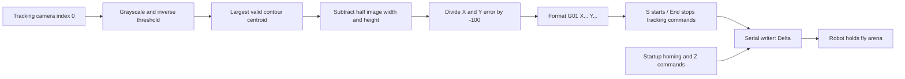

# Delta robot fly tracking: recovery guide

Recovery prepared 28 October 2026. **Start with the offline demo. Use the separate Bonsai 2.7.1 environment in this folder.** The historical files outside this folder were preserved; videos and experimental data were not opened.

## Open it now

- **`Open Offline Demo.cmd`** opens Bonsai 2.7.1 and starts a synthetic camera. Press **S** to send calculated motion strings to an onscreen node, then **End** to stop that command stream. Double-click **Tracking**, then **SyntheticFly** to view the artificial image; double-click **CommandProbe** at the top level to view commands. Use **Shift+F5** to stop the whole workflow. Restart with **F5** after End.
- **`Open Controller for Inspection.cmd`** opens the recovered real controller **without starting it**. It requires physical camera/serial hardware to run.
- **`Validate-Offline.ps1`** repeats source checks, compilation, and the two synthetic tests. Close the recovery editor before rebuilding its DLL.

**F5 on the real controller can immediately send `G28` and `G01 Z-263 F100`. S only gates tracking commands. End is not an emergency stop for queued robot motion.**

## Which version is the latest?

The newest saved controller is **`Bonsai/ImageSta/DeltaX2Move2PashaModifyed_Last_3cameras.bonsai`, 13 April 2023**. Its saved workflow version is **2.7.1**. `controller/Delta-Controller.bonsai` is a copy of it with one correction: the old absolute command-log filename is now `recordings\commands.csv`. Its matching layout is included. Camera settings, control commands, gains, and disabled nodes are preserved.

| Historical candidate | Evidence from this recovery |
|---|---|
| Root `DeltaX2Move2PashaModifyed_Last.bonsai`, 9 Apr | Two extra Hikrobot recorder branches are enabled. Does **not compile with the surviving bundled camera package**: an `Image` selector follows a node that already returns `IplImage`. This does not establish which camera DLL was used on the original rig. |
| Root `DeltaX2Move2PashaModifyed_Last_3cameras.bonsai`, 10 Apr | Compiles with the pinned environment. Auxiliary camera/recorder branches are disabled. Threshold 119, minimum contour area 50. Used as a simple historical reference. |
| `Bonsai/ImageSta/...Last_3cameras.bonsai`, 13 Apr | Compiles. Same control graph, threshold 163, minimum area 20, camera exposure -7. Newest saved parameter variant. |

**The latest hardware-functional version cannot be established without the original hardware/configuration or execution records.** File dates and compilation establish the latest saved and software-compatible candidates. Existing videos/data were excluded as requested.

## Recreate the environment

This folder already contains a restored local environment. On another Windows computer install a **.NET 8 or 9 SDK**, **Python 3**, and **.NET Framework 4.7.2 or newer**. Windows 11 normally supplies a newer Framework. Then run in PowerShell:

```powershell
powershell.exe -NoProfile -ExecutionPolicy Bypass -File .\Restore-Environment.ps1
powershell.exe -NoProfile -ExecutionPolicy Bypass -File .\Validate-Offline.ps1
```

The restore uses the [official Bonsai 2.7.1 portable release](https://github.com/bonsai-rx/bonsai/releases/tag/2.7.1), a locked NuGet dependency graph, and the original local camera package. It creates `runtime/` without changing the system Bonsai installation. Old MyGet defaults are replaced locally with NuGet.org and a downloaded package feed. This also avoids the machine's existing disabled remote sources. See [Bonsai environment documentation](https://bonsai-rx.org/docs/articles/environments.html).

The 2.7.1 console bootstrapper can return failure after successful first-time package installation because it awaits a cancelled `OnlyOnFaulted` continuation. The script verifies every registered package/assembly and the native OpenCV DLL, then requires a successful second startup. It does not treat that initial failure code alone as success. The downloaded portable ZIP is checked against the SHA256 recorded during this recovery.

| Component | Pinned version | Purpose |
|---|---|---|
| Bonsai executable, Editor, Core | 2.7.1 | Historical editor and workflow compiler |
| Vision, Vision.Design, System, System.Design, Dsp, Windows.Input | 2.7.0 | Image processing, serial I/O, keyboard controls |
| Scripting.Expressions, Scripting.Expressions.Design | 2.7.0 | Inline coordinate and command expressions |
| OpenCV.Net | 3.4.1 | Managed image API |
| OpenCV native Windows packages | 2.4.13 | Native DLLs required by OpenCV.Net 3.4.1; restored into its runtime folders |
| Bonsai.MvCamCtrl | 0.1.0 | Original bundled Hikrobot operator, preserved in `local-packages/` |
| MvCamCtrl.Net | 4.0.0 | Managed Hikrobot SDK |

`environment/Bonsai.config` lists all 27 runtime packages and their assembly/native paths. `environment/packages.lock.json` also locks the two native download packages. These versions are a reconstructed compatible environment, not a recovered original installation manifest; no old Bonsai.config survived here.

The working tracking branch uses **generic CameraCapture index 0**. The pinned Hikrobot package supports the archived camera nodes, but the two recorder branches are disabled in the recommended controller. **Spinnaker/FLIR is not required by the tested controller with that legacy branch disabled.** Do not install current camera packages just to resolve disabled legacy operators.

When reconnecting Hikrobot cameras, the folder contains **MVS 4.0.0** and **MVS 3.4.1** installers. The bundled managed package points to SDK **4.0.0**. The native MVS driver/runtime and actual camera model still need to be checked on the rig; NuGet does not install the USB/GigE driver. This recovery did not install or change MVS. OpenCV native execution passed on this PC; another PC may need the Microsoft Visual C++ 2015–2022 x64 runtime if DLL loading fails.

## How the controller works



The setpoint is the **image center**. `ScalingFactorX` and `ScalingFactorY` expose the two divisors inside **CommandsGain**; their saved defaults are **-100**. For example, a fly 40 pixels to the right produces an X command of -0.4. The physical units, sign and correct scale must be established on the rig. This is proportional position-error feedback, with relative motion requested by the saved `G91` startup command.

The active detector uses an inverse intensity threshold and the largest connected component above the minimum area. The 10-frame window is disabled; the synthetic test preserves successive positions without temporal averaging. Thresholds and contour area will need tuning against real contrast, reflections and magnification.

**Port configuration:** connection name `Delta`, old port **COM19**, **115200 baud, 8 data bits, no parity, 2 stop bits**, no handshake, RTS on, DTR off. Written lines end with CRLF. Change the physical port in **CreateSerialPort**, retaining the connection name `Delta` used by the writer.

**Startup strings:** a separate `G28` branch plus `G90`, `G01 Z-263 F100`, `G91`, `M203 S8000`, `M204 A20000`, `M205 S800`. The six later strings are concatenated in order, but there is no explicit controller-acknowledgement gate or confirmed homing completion. The disabled reader points at COM5. Robot firmware, coordinate conventions, dimensions, homing limits, serial adapter identity and calibration files were not found among the inspected software sources.

**Controls as saved:** S starts vision commands; End stops that stream. Arrow jogs, A/Q Z jogs and mouse control are disabled. Their stored mappings are documented in `WORKFLOW_AUDIT.md`; they do nothing unless explicitly enabled. `Shift+F5` stops Bonsai, which does not prove that queued motion is stopped in robot firmware. The historical number formatting uses the Windows culture; use a decimal-point culture or explicitly fix formatting before physical use on a decimal-comma system. The synthetic test fixes its own culture for repeatability.

## What passed without hardware

- XML parsing and edge-index checks of every archived workflow; original source hashes preserved.
- Compile-only checks of the April 10 and April 13 controllers and the recovered controller. The validator builds and compiles expression trees without invoking them or subscribing to camera/serial sources.
- Synthetic execution of the extracted tracking and command groups from both April parameter variants: **80 frames, 8 blank frames, 72 expected commands, maximum command-value error 0**. A small distractor is below the contour-area cutoff. Assertions check the actual frame counts and every output against known disk coordinates.
- Your `itskovpa/bonsai-mcp-server` was built successfully and used to inspect the graph and open the offline workflow without execution. No Codex/model/MCP configuration was changed.

The finite self-tests replace cameras and keyboard events, remove serial/startup/recording branches, and wire the processing groups directly instead of through persistent named subjects. The interactive demo retains the historical named subjects and S/End gates. These are software signal-path tests, not a simulation of robot mechanics or a real-time performance measurement. UI capture approval timed out, so direct visual verification and actual keyboard gate behavior were not certified.

Results are saved in `validation/offline-test-result-april10.json` and `validation/offline-test-result-april13.json`; diagnostic logs remain local in `logs/`.

## Recommission when the hardware returns

1. Identify the robot/controller, firmware, mechanical workspace, emergency stop, power sequence and COM port. Verify 115200/8N2 against its controller documentation. Review the saved homing/Z commands before allowing motor power.
2. Open `originals/camera.bonsai` with `runtime/Bonsai.exe` for the **camera-only** check first; confirm camera identity/index, resolution, exposure and image orientation. Camera indices can change with USB enumeration. Find a stable centroid on the fly and confirm blank frames produce no valid location.
3. Disable automatic startup/motion output while measuring the setpoint, pixel scale and axis signs. Check one small movement at a time and establish bounds. The archived workflow has no software travel clamp or calibrated scale.
4. Establish homing and command-completion handling for the actual firmware. Then test bounded, low-gain correction with a stationary target before a live fly. Measure centering error, overshoot, dropped frames and camera-to-motion latency.
5. Add the two extra recording cameras only after the single-camera loop is reliable. With this bundled MvCamCtrl package, remove or bypass the following `Image` selector because its output already is `IplImage`; compile again before enabling the branch. Confirm codec, capture rate, timestamps and storage independently. A VideoWriter frame-rate value is a recording setting, not evidence of camera capture rate.

## Other files and experiments

`Bonsai/ImageSta/camera.bonsai` is a separate live Hikrobot segmentation/head-tail experiment, without robot serial control. `ImageSta.bonsai` is a file-based analysis composition; its FileCapture filename is empty. Its original extensions project targets net472 with Core/Vision 2.6.0 and OpenCV.Net 3.3.1. Those project references are not evidence that the April 2023 robot controller needs Bonsai 2.6.

These analysis workflows additionally use **Bonsai.Scripting.IronPython**. Version **2.7.0** is available with Core >=2.7.0 and IronPython / IronPython.StdLib >=2.7.5 dependencies. This optional stack was verified from its package manifest but was not installed or certified here. The historical `Image` selector mismatch and C# `HeadTailVisualizer` compilation need to be addressed in a separate analysis working copy. Existing file/video inputs were deliberately not used.

Earlier CoreXY/plotter/Magnet workflows are retained as historical alternatives. Their older camera/Python packages are not dependencies of the recovered delta controller. Manufacturer plotter software and camera installer contents were not treated as project source.

`originals/` is a source-only snapshot, `source-manifest.json` records SHA256 hashes, `WORKFLOW_AUDIT.md` contains detailed source evidence, and `controller/` is the working real-controller copy. `prepare_sources.py` regenerates working copies from the archived originals, so save intentional future edits separately before rerunning it.
